# 👨‍💻 Luan Felipe Quartezani Stecanela

**`Desenvolvedor Full Stack`**

Olá! 👋 Me chamo Luan Felipe Quartezani Stecanela, sou de Brasília, no Distrito Federal. Sou formado em Análise e Desenvolvimento de Sistemas na Uniasselvi e atuo no desenvolvimento de sistemas web para a área da saúde. No front-end trabalho com React, Next.js, TypeScript e Tailwind CSS. No back-end, com Java, Python, Django REST Framework, PostgreSQL e Docker. Antes do desenvolvimento, construí base em suporte técnico e infraestrutura de TI, com a certificação HDI Desktop Advanced Support Technician e alguns outros cursos na área de TI e desenvolvimento.

    
    
    

---

### 🤖 Linguagens e Tecnologias

 
 

### 📊 Estatísticas

  

